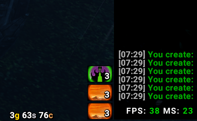
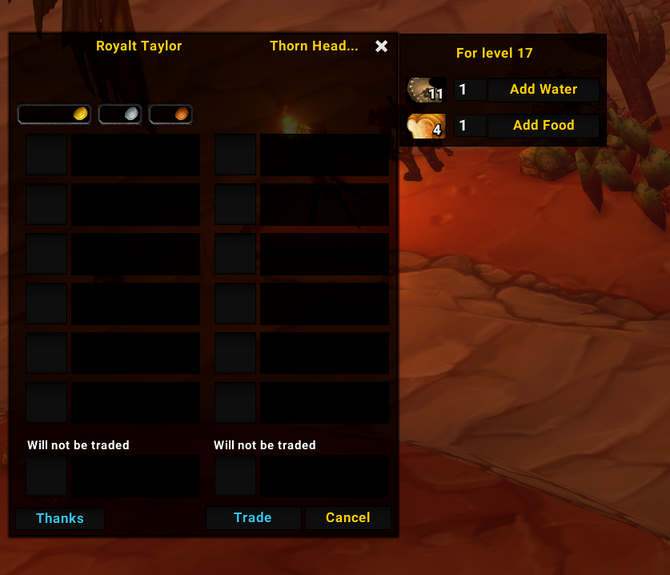
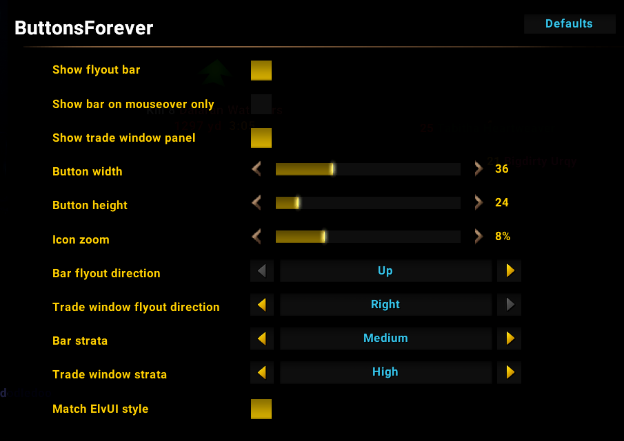

# ButtonsForever

[](https://www.curseforge.com/wow/addons/buttonsforever)
[](https://addons.wago.io/addons/buttonsforever)
[](https://github.com/theycallmek/ButtonsForever/releases/latest)

Download from [CurseForge](https://www.curseforge.com/wow/addons/buttonsforever), [Wago](https://addons.wago.io/addons/buttonsforever) or [GitHub Releases](https://github.com/theycallmek/ButtonsForever/releases/latest).

A mage addon for **World of Warcraft: Forever**. It folds every city teleport and portal into two flyout buttons, adds a trade window helper for conjuring and handing out food and water, and keeps you stocked on runes with a low-rune alert and auto-buy.

The addon does nothing on characters that aren't mages.

## Features

### Teleport and Portal flyouts


- A small bar with two buttons, **Teleports** and **Portals**. Click one to open a flyout of the city spells you know, then click a city to cast it. The flyout closes after casting, or when you click anywhere else. In combat, clicking elsewhere doesn't close it, because WoW blocks addons from doing that; click the button again instead.
- They work in combat.
- Each button shows how many runes you have: Rune of Teleportation for teleports, Rune of Portals for portals. The number turns red at 0.
- **Shift-drag** either button to move the bar. Its position is saved.

### Low-rune alert
When you're near a rune vendor and running low on a rune you need, the addon tells you to restock. "Near" means:

- **Capital cities:** anywhere in Stormwind, Ironforge, Darnassus, Orgrimmar, Undercity or Thunder Bluff.
- **Towns:** when you walk into the town of a rune vendor in Elwynn Forest, Duskwood, Swamp of Sorrows, Wetlands, Alterac Mountains, Arathi Highlands, Hillsbrad Foothills, The Hinterlands, The Barrens, Ashenvale, Thousand Needles, Stonetalon Mountains, Feralas, Dustwallow Marsh and Silithus. Entering the zone alone doesn't set it off; it goes off when you walk into the vendor's town, such as Crossroads or Astranaar. Towns are recognised by ID, so this works in every language.
- **Your faction only:** vendors in the other faction's cities and towns never alert you, since you can't buy from them. Neutral vendors in Alterac Mountains, Arathi Highlands and Silithus alert everyone.

How it works:

- **When it fires:** when you have that many of a rune or fewer, 1 by default (you pick 0–20). It checks only on game events, with no timers running: when you enter a zone, city or area, when your bags change (so using a rune there can set it off), and when you close a vendor.
- **The warning:** "You have 1 Rune of Teleportation left. Buy more from a reagent vendor." It can show in the middle of the screen like a raid warning, in chat, or both, with a sound you choose.
- **Vendor marker:** it puts a rune icon on your world map and minimap at the nearest rune vendor. If the vendor is beyond the minimap's range, the icon sits dimmed on the minimap's edge, pointing the way. It's the addon's own marker, so any waypoint you've set is left alone. It's removed once you've restocked above the threshold or left the area.
- It warns once per visit for each rune, and only about runes used by spells you know. A mage who hasn't learned portals yet won't be warned about Runes of Portals.

### Auto-buy runes
When you open a vendor that sells runes, the addon tops you up to the amount you set, 10 of each by default:

- **Only the difference:** with 3 Runes of Teleportation in your bags and a target of 10, it buys 7. If you already have enough, nothing happens.
- **Confirmation:** by default a popup shows what it will buy and the total price, for example "Buy 7 x Rune of Teleportation, 10 x Rune of Portals for …?" with the price filled in. Turn the confirmation off to buy straight away. Either way, chat says what was bought.
- **Gold:** if you can't afford it, it buys nothing and says how much gold is needed.
- **Your spells:** it only buys runes for spells you know. Set an amount to 0 to never buy that rune.

### Trade window helper
Open a trade with someone and a panel appears beside the trade window:



- **A Portal flyout**, for porting the person you're trading with.
- **Conjure Water / Conjure Food** buttons cast the highest rank your trade partner can use. For example, a level 17 gets level 15 water. If you don't know that rank yet, they use the best one you do know. The panel title shows your partner's level.
- The number on each Conjure button is how much of that food or water in your bags your partner can use.
- **Add Water / Add Food** put full stacks of 20 into the trade window, highest usable rank first. Type how many stacks (1–6) in the box beside each button; the amounts are remembered. You still click Trade yourself, because addons aren't allowed to accept trades.

### Settings
Type `/bf` (or `/buttonsforever`), or go to **Esc → Options → AddOns → ButtonsForever**.



| Setting | What it does |
|---|---|
| Show flyout bar / Show trade window panel | Turn either half of the addon off if you only want the other |
| Show bar on mouseover only | Keeps the bar invisible until you hover it. It stays visible while a flyout is open |
| Button width / height | Set independently, 16–80 pixels |
| Icon zoom | Crops the icon's edges, 0–30%. Non-square buttons crop instead of stretching the icon |
| Bar flyout direction | Up, Down, Left or Right (default Up) |
| Trade window flyout direction | Up, Down, Left or Right (default Right) |
| Bar strata / Trade window strata | Which interface layer each part is drawn on, from Background to Tooltip (defaults Medium and High). Raise it if other frames cover the buttons |
| Match ElvUI style | Uses ElvUI's look when ElvUI is installed. Needs `/reload` |
| **Low-rune alert** | Turns the rune warning on or off (default on). The settings below it grey out while it's off |
| Alert when runes are at or below | Warn at this many runes or fewer, 0–20 (default 1). 0 warns only when you're out |
| Alert on screen / Alert in chat | Where the warning shows: the middle of the screen like a raid warning, the chat window, or both (both on by default) |
| Mark vendor on map | A marker on the world map and minimap at the nearest rune vendor (default on). Your own waypoint isn't touched |
| Alert sound | None, Raid warning (default), Ready check, Alarm clock, Whisper or Map ping. Picking one plays it |
| Test alert sound | A **Play** button that plays the chosen sound |
| **Auto-buy runes** | Turns auto-buy on or off (default on). The settings below it grey out while it's off |
| Auto-buy Runes of Teleportation / Portals | How many of each to keep, 0–100 (default 10). 0 never buys that rune |
| Confirm auto-buy | Ask before buying (default on) |

## Installation

Copy the `ButtonsForever` folder into your Forever AddOns folder, for example `World of Warcraft\_forever_\Interface\AddOns\ButtonsForever`, then restart the game or `/reload`.

## Languages

Spells and items are looked up by ID, so the addon works on every client. The addon's own labels are translated for German, Spanish (Spain and Mexico), French, Portuguese (Brazil), Russian, Korean, and Simplified and Traditional Chinese. Italian uses English, matching Forever's Italian client.

The spell terms in each translation were checked against wowhead's in-game names. The rest of the wording is a draft, and corrections from native speakers are welcome. To add or fix a language, edit `Locales.lua`. Any missing text falls back to English.

## Development

| File | Contents |
|---|---|
| `ButtonsForever.toc`, `ButtonsForever_Forever.toc` | Addon metadata, Interface `16001`. Identical; the `_Forever` copy tells WoWUp it's a Forever addon, so keep both in sync |
| `Locales.lua` | Translated UI text |
| `Logic.lua` | Pure logic with no game API: rank picking, stack picking, icon cropping, rune alert and auto-buy amounts, vendor distance, minimap marker position |
| `ButtonsForever.lua` | Frames, secure buttons, events, settings, and the rune vendor locations |

Run the out-of-game tests with [LuaJIT](https://luajit.org/), which uses Lua 5.1 like WoW:

```
luajit test_logic.lua
luajit test_locales.lua
```

`test_locales.lua` checks that every language has every label, with matching `%d` placeholders.

### Notes
- Spell and item IDs are Classic Era's, which Forever reuses. Each one has a comment naming the spell or item, and they were checked against wowhead's Forever pages.
- Cities and zones are recognised by map ID (Classic's), and the rune vendor coordinates come from wowhead's Forever data.
- Forever uses retail's (Midnight's) addon restrictions. Spells are cast only from secure buttons, and the flyouts open through a secure handler, which is what lets them work in combat. Size and layout changes made in combat apply when combat ends.
