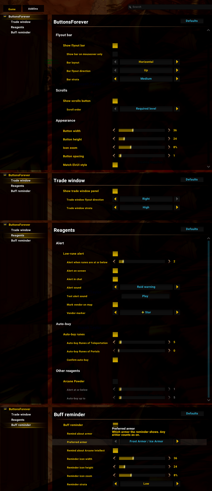

# ButtonsForever

[](https://www.curseforge.com/wow/addons/buttonsforever)
[](https://addons.wago.io/addons/buttonsforever)
[](https://github.com/theycallmek/ButtonsForever/releases/latest)

A mage addon for **World of Warcraft: Forever**. It gives you:

- **Flyout buttons** for every city teleport and portal, plus Forever's mage scrolls.
- **A trade window helper** that conjures and hands out the right food and water.
- **Reagent help:** a low-rune alert near vendors, a vendor marker on the map, and auto-buy.
- **A buff reminder** for your armor and Arcane Intellect.

It does nothing on characters that aren't mages.

## Installation

Download from [CurseForge](https://www.curseforge.com/wow/addons/buttonsforever), [Wago](https://addons.wago.io/addons/buttonsforever) or [GitHub Releases](https://github.com/theycallmek/ButtonsForever/releases/latest).

To install by hand, copy the `ButtonsForever` folder into your Forever AddOns folder, for example `World of Warcraft\_forever_\Interface\AddOns\ButtonsForever`, then restart the game or `/reload`.

## Features

### Flyout bar


- **Teleports** and **Portals:** click a button to open a flyout of the city spells you know, including Forever's Teleport: Dalaran, then click a city to cast. Works in combat.
- **Scrolls:** Forever's 22 mage scrolls from the Bundle of Scrolls, such as Scroll of Minor Evocation. Only scrolls in your bags are listed, and the button only shows while you have one.
- Each button shows how many runes or scrolls you have. The number turns red at 0.
- A flyout closes after you cast, or when you click anywhere else. In combat WoW won't let addons close it that way, so click its button again.
- **Shift-drag** any button to move the bar.

### Trade window helper


When you open a trade, a panel appears beside the trade window:

- **Portal flyout**, to port the person you're trading with.
- **Conjure Water / Conjure Food** cast the highest rank your partner can use. A level 17 gets level 15 water. If you don't know that rank, you get your best one. The panel title shows their level.
- The number on each Conjure button is how much of it in your bags your partner can use.
- **Add Water / Add Food** put full stacks into the trade, highest usable rank first. Type how many stacks (1–6) in the box beside each button. You still click Trade yourself, because addons can't accept trades.

### Reagents: alert, vendor marker and auto-buy

<!-- screenshot: .previews/vendor-marker.png (map or minimap marker with the vendor tooltip) -->

Covers Rune of Teleportation, Rune of Portals and Arcane Powder, and only those you need for spells you know.

**Low-reagent alert.** When you're near a rune vendor and have 1 or fewer of a reagent, you get "You have 1 Rune of Teleportation left. Buy more from a reagent vendor." on screen like a raid warning, in chat, and with a sound. It warns once per visit for each reagent. "Near a vendor" means:

- anywhere in Stormwind, Ironforge, Darnassus, Orgrimmar, Undercity or Thunder Bluff;
- inside the vendor's town in Elwynn Forest, Duskwood, Swamp of Sorrows, Wetlands, Alterac Mountains, Arathi Highlands, Hillsbrad Foothills, The Hinterlands, The Barrens, Ashenvale, Thousand Needles, Stonetalon Mountains, Feralas, Dustwallow Marsh and Silithus. Entering the zone isn't enough; you have to walk into the town, such as Crossroads or Astranaar;
- your own faction's vendors only. The neutral ones in Alterac Mountains, Arathi Highlands and Silithus count for everyone.

**Vendor marker.** With the alert, a rune icon marks the nearest vendor on your world map and minimap. Your own waypoint isn't touched. If the vendor is out of minimap range, the icon sits dimmed on the edge, pointing the way. Hover it to see the vendor's name (or all of them, in a city with several). Click it out of combat to target the vendor and put a star on them. The marker goes away once you've restocked or left.

**Auto-buy.** When you open a vendor that sells them, it tops you up to 10 of each rune and 20 Arcane Powder:

- It buys only the difference. With 3 runes and a target of 10, it buys 7.
- A popup shows what it will buy and the total price first. You can turn the popup off.
- If you can't afford it, or your bags don't have room, it buys nothing and says why in chat.

The alert and auto-buy check only on game events, such as entering an area, your bags changing or a vendor opening or closing. There are no timers running.

### Buff reminder

<!-- screenshot: .previews/buff-reminder.png (the two greyed-out reminder icons) -->

A greyed-out icon shows while one of your self-buffs is missing:

- **Armor:** when none of Frost Armor, Ice Armor or Mage Armor is on you. The icon is your best rank of the armor you prefer.
- **Arcane Intellect:** when neither Arcane Intellect nor Arcane Brilliance is on you, including one from another mage.

Clicks pass through the icons; hold **Shift** to drag them. They hide while you're dead. In combat the game hides your buffs from addons, so the icons update when combat ends.

## Settings

Type `/bf` (or `/buttonsforever`), or go to **Esc → Options → AddOns → ButtonsForever**. Each setting has a tooltip in game. Settings under an on/off switch grey out while it's off.



| Page | What you can set |
|---|---|
| **ButtonsForever** | Show the bar; show it on mouseover only; horizontal or vertical layout; flyout direction (Up); draw layer, or strata (Medium). Show the Scrolls button, and order scrolls by required level, name or most in bags. Button width and height (16–80, default 36), icon zoom (0–30%, default 8) and spacing (0–20, default 3) for every button. Match ElvUI's style (needs `/reload`) |
| **Trade window** | Show the panel; flyout direction (Right); strata (High) |
| **Reagents** | Turn the alert on or off; alert at or below (0–20, default 1); on screen, in chat, and which sound, including LibSharedMedia sounds from other addons such as ElvUI, with a Play button; mark the vendor on the map; which raid marker to put on the vendor (Star). Auto-buy on or off; how many runes of each to keep (0–100, default 10); confirm first. Arcane Powder on or off, with its own alert level (1) and amount to keep (20) |
| **Buff reminder** | Turn the reminder on or off; armor and Arcane Intellect separately; preferred armor (Frost/Ice or Mage); icon width, height, zoom and strata |

Strata is the interface layer something is drawn on. Raise it if other frames cover the buttons.

## Languages

Spells, items and towns are looked up by ID, so the addon works on every client. Its own text is translated for German, Spanish (Spain and Mexico), French, Portuguese (Brazil), Russian, Korean, and Simplified and Traditional Chinese. Italian uses English, like Forever's Italian client. Rune vendor names are built in for every language, from wowhead's translated lists, so clicking the vendor marker targets the right NPC.

The spell names were checked against wowhead. The rest is a draft, and corrections from native speakers are welcome in `Locales.lua`. Anything missing falls back to English.

## Development

| File | Contents |
|---|---|
| `ButtonsForever.toc`, `ButtonsForever_Forever.toc` | Addon metadata, Interface `16001`. Keep both identical; the `_Forever` copy tells WoWUp it's a Forever addon |
| `ButtonsForever.lua` | Frames, secure buttons, events, settings, and the spell, item and vendor data |
| `Logic.lua` | Pure logic with no game API: rank and stack picking, scroll sorting, icon cropping, alert and auto-buy plans, bag space, vendor distance, minimap marker position |
| `Locales.lua` | Translated text and vendor names |
| `icon.tga` | The 64×64 icon in the AddOn List |

Run the tests with [LuaJIT](https://luajit.org/), which uses Lua 5.1 like WoW:

```
luajit test_logic.lua
luajit test_locales.lua
```

`test_locales.lua` checks that every language has every label with matching placeholders, and that every translated vendor name belongs to a real vendor.

Notes:

- Spell, item and map IDs are Classic Era's, which Forever reuses. Each has a comment naming it, and they were checked against wowhead's Forever pages, as were the vendor coordinates.
- Forever uses retail's (Midnight's) addon rules. Spells are cast only from secure buttons, and flyouts open through a secure handler, which is why they work in combat. Size and layout changes made in combat apply when it ends.
